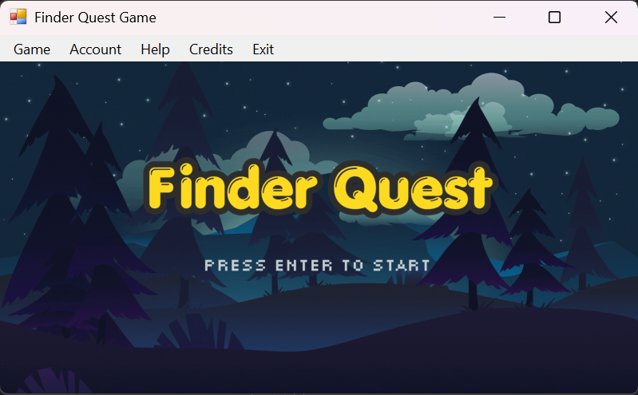
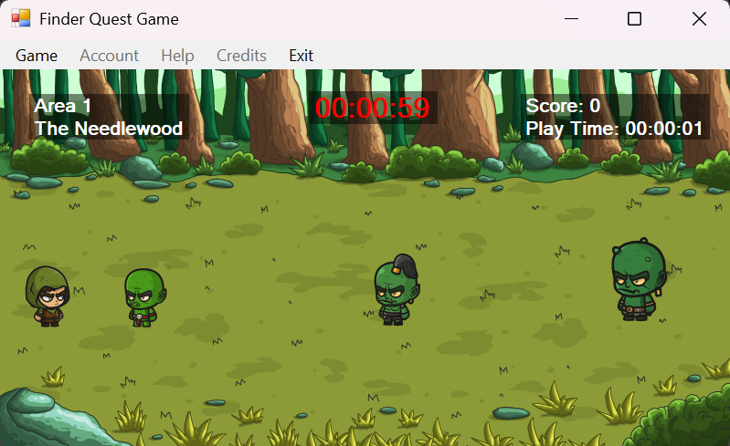
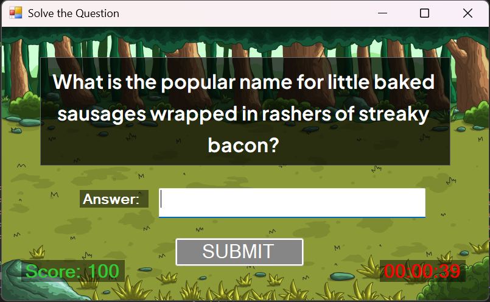
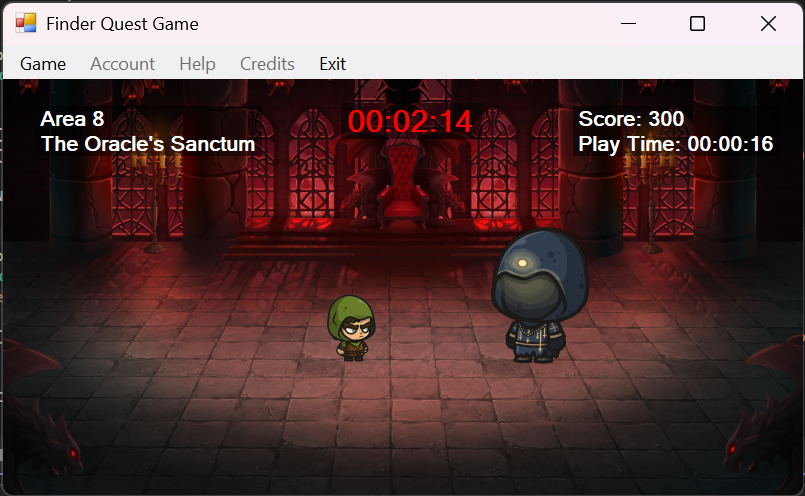
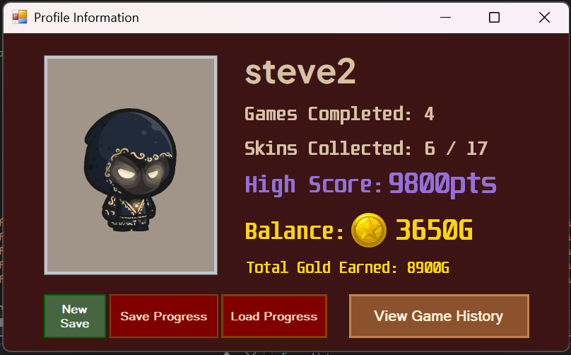
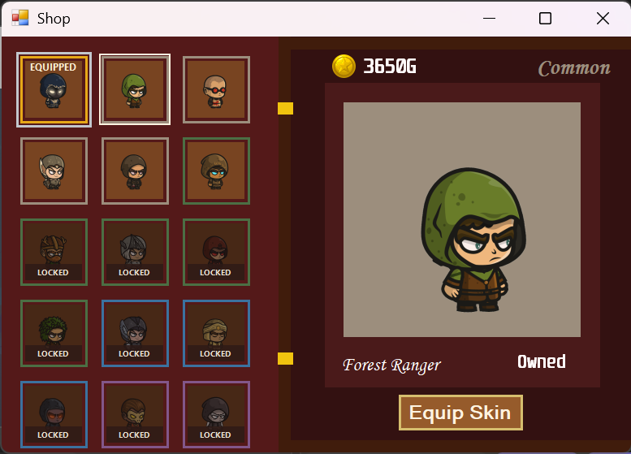

# FinderQuest


> **1st Place Winner** (out of 35 student teams) – OOP Game Student Challenge


FinderQuest is a story-infused 2D desktop trivia game built in C# using Windows Forms. It combines high replayability—powered by dynamic API question pooling, an in-game currency and cosmetic shop, and a flicker-free GDI+ rendering engine.


## Gameplay Preview
| Main Menu | World & Exploration |
| :---: | :---: |
|  |  |
| Trivia Questions | Boss Encounters |
| :---: | :---: |
|  |  |
| Account System | Skin & Cosmetic Shop |
| :---: | :---: |
|  |  |

---

## Key Features

* **Custom GDI+ Rendering Engine:** Overhauled the graphics pipeline to use GDI+ rendering and double-buffering to eliminate screen flickering to ensure smoother gameplay.

* **Dynamic API-Driven Questions:** Integrated The Trivia API for dynamic question pooling, randomizing question sets on every replay.

* **In-game Currency and Cosmetic Shop:** Developed an in-game shop economy, where players can earn currency and use it to unlock and equip a collection of character skins.

* **Modular OOP Architecture:** Developed a scalable class structure to handle game logic, sounds, cutscenes, and in-game area management.

---

## Tech Stack & Tools

* **Language:** C#

* **Framework:** .NET / Windows Forms (WinForms)

* **Graphics API:** GDI+

* **IDE:** Microsoft Visual Studio

* **Version Control:** Git / GitHub

---

## Setup & Installation

### Requirements

* **OS:** Windows 10/11

* **IDE:** Microsoft Visual Studio 2026 (with .Net Desktop Development workload)

* **Display Note:** Designed for **150 Windows Display Scaling**(standard for 1080p laptop displays). Full screen scaling is not supported.


> 💡 **Tip:** If UI elements look misaligned or clipped, right-click your Desktop → **Display settings** → set **Scale** to **150%**.


### Installation Steps

1. **Clone the Repository**

   ```bash

   git clone https://github.com/Ryan-Melvin/FinderQuest.git

   ```

2. **Open the Project Folder**

   * Navigate to the Project Folder and open FinderQuest.slnx in Visual Studio.

3. **Build the Solution**

   * Press **Ctrl + Shift + B** to build the solution.

4. **Copy Sound Assets**

   * Copy the sounds folder inside /FinderQuest in the project folder and paste it inside /bin/Debug/

5. **Install Fonts (Optional)**

   * Open the fonts folder inside /FinderQuest in the project folder and double click on all the files there.

6. **Run the Game**

   * Run the game by Pressing F5 or hit Start in Visual Studio.

---

## Team & Contributions

* **[Ryan Melvin Yuandy](https://github.com/Ryan-Melvin)** - Team Lead | Core Game Mechanics & GDI+ Graphics Engine Overhaul.

* **[Stevrian Irwan Phan](https://github.com/stevrian-irwan)** - Trivia API Integration & Account System

* **[Jason Donelly](https://github.com/Jaesn2)** - Currency & Cosmetic Shop System

---

## Credits & External Assets

* **Character Sprites & Background:** [Craftpix](https://craftpix.net/).

* **Cutscene Background:** upklyak & pikisuperstar on [Freepik](https://www.magnific.com/app).

* **Music:** [Dova Syndrome](https://dova-s.jp/en/).

* **NPC SFX:** [Pixabay](https://pixabay.com/sound-effects/).

* **Trivia Data:** Powered by [The Trivia API](https://the-trivia-api.com/).

